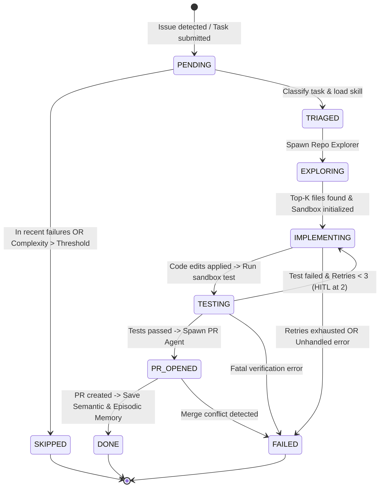

# CodePilot — Comprehensive Implementation Details

This document provides an exhaustive, low-level technical explanation of the architecture, algorithms, protocols, and data structures implemented in **CodePilot**.

---

## 1. Multi-Agent Orchestration & State Machine

CodePilot implements a multi-agent system using **DeepAgents** and **LangGraph** where the **Orchestrator** operates as the root agent, delegating specialized duties to child agents via on-demand task delegation.

### 1.1 Root Orchestrator Architecture

The root agent is defined in [`codepilot/agents/orchestrator.py`](file:///c:/AI%20Engineering%20Course/Projects/Capstone%20Project/codepilot/agents/orchestrator.py).

```
┌────────────────────────────────────────────────────────┐
│                   OrchestratorAgent                    │
│  - create_deep_agent(model, prompt, tools)             │
│  - Task classifier (heuristics + prompt)               │
│  - Complexity triage scorer (1–10 scale)               │
│  - State Machine Driver                                │
└──────────────────────────┬─────────────────────────────┘
                           │
         ┌─────────────────┼─────────────────┐
         ▼                 ▼                 ▼
┌─────────────────┐ ┌───────────────┐ ┌──────────────┐
│  Repo Explorer  │ │  Coder Agent  │ │   PR Agent   │
│  (Map & Search) │ │ (Sandbox Edit)│ │ (Commit & PR)│
└─────────────────┘ └───────┬───────┘ └──────────────┘
                            │
                            ▼
                    ┌───────────────┐
                    │  Test Agent   │
                    │ (Verify/Heal) │
                    └───────────────┘
```

#### Initialization & Model Configuration
- **Model Provider**: Backed by `ChatGoogleGenerativeAI(model="gemini-3.8-flash")` with configurable parameters via [`CodePilotConfig`](file:///c:/AI%20Engineering%20Course/Projects/Capstone%20Project/codepilot/config.py).
- **Tool Attachment**: Equipped with GitHub tools ([`codepilot/github/toolkit.py`](file:///c:/AI%20Engineering%20Course/Projects/Capstone%20Project/codepilot/github/toolkit.py)) including `list_open_issues`, `get_issue_details`, `create_github_branch`, and `create_pull_request`.
- **DeepAgent Wrapper**: Instantiates `create_deep_agent()` with `TodoListMiddleware`, `FilesystemMiddleware`, and `SkillsMiddleware` hooks.

### 1.2 Orchestrator State Machine Specification

Each task progresses through a strict finite state machine (FSM) defined in [`TaskStatus`](file:///c:/AI%20Engineering%20Course/Projects/Capstone%20Project/codepilot/state.py):

$$\text{PENDING} \longrightarrow \text{TRIAGED} \longrightarrow \text{EXPLORING} \longrightarrow \text{IMPLEMENTING} \longrightarrow \text{TESTING} \longrightarrow \text{PR\_OPENED} \longrightarrow \text{DONE} \mid \text{FAILED}$$



#### State Transition Details:
1. **`PENDING` &rarr; `TRIAGED`**:
   - Issue is deduplicated against `self.in_progress_issues`.
   - Issue is checked against `episodic_memory.get_recently_failed_issue_numbers(limit=3)`.
   - Issue complexity is calculated (1–10). If $> \text{threshold}$ (default 7), status becomes `SKIPPED`.
   - `classify_task()` determines `TaskType` (`bug_fix`, `feature_addition`, `dependency_update`, `documentation`, `config_change`).
   - Appropriate `Skill` is resolved from [`SkillsRegistry`](file:///c:/AI%20Engineering%20Course/Projects/Capstone%20Project/codepilot/skills/loader.py).
2. **`TRIAGED` &rarr; `EXPLORING`**:
   - `RepoExplorerAgent` executes `explore()`.
   - Cached or fresh `RepoMap` is generated.
   - Top-K files are retrieved and injected into `working_memory.relevant_files`.
   - Semantic Memory is queried for top-3 relevant past lessons.
3. **`EXPLORING` &rarr; `IMPLEMENTING`**:
   - Isolated sandbox is created at `.codepilot_sandbox/<task_id>/`.
   - Relevant files are copied into the sandbox directory.
   - Initial file snapshots are recorded for unified diff calculation.
   - Coder Agent applies surgical code modifications via `SEARCH/REPLACE` blocks or targeted fallback patches.
4. **`IMPLEMENTING` &rarr; `TESTING`**:
   - `TestAgent` executes sandbox test runner (`pytest` or `unittest`).
   - If tests fail and `retry_count < 3`, control returns to `IMPLEMENTING`.
   - If `retry_count >= 2`, HITL gate `check_retry_threshold()` interrupts execution for human approval.
5. **`TESTING` &rarr; `PR_OPENED`**:
   - `proposed_diff.txt` is compiled from sandbox file snapshots.
   - `PRAgent` checks HITL gates for `main` target branch and $>5$ file modifications.
   - Git branch `codepilot/issue-{id}-{slug}` is created.
   - Structured commit is committed to git.
   - PR is opened on GitHub (or mock provider).
6. **`PR_OPENED` &rarr; `DONE`**:
   - Newly learned lesson is embedded and persisted into ChromaDB.
   - Task execution record is logged into Episodic Memory.
   - Working memory is wiped cleanly.

---

## 2. Context Engineering & Repo Map Algorithms

The primary challenge in coding agents is handling repositories with hundreds of files within model context limits. CodePilot implements a multi-stage context compression pipeline in [`codepilot/context/repo_map.py`](file:///c:/AI%20Engineering%20Course/Projects/Capstone%20Project/codepilot/context/repo_map.py).

### 2.1 AST Symbol Extraction Algorithm

For Python files, CodePilot uses the built-in `ast` parser to extract signatures without executing code:

```python
tree = ast.parse(content)
description = (ast.get_docstring(tree) or "").split("\n")[0].strip()
for node in ast.iter_child_nodes(tree):
    if isinstance(node, (ast.FunctionDef, ast.AsyncFunctionDef)):
        symbols.append(f"{node.name}()")
    elif isinstance(node, ast.ClassDef):
        symbols.append(f"class {node.name}")
        for item in node.body:
            if isinstance(item, (ast.FunctionDef, ast.AsyncFunctionDef)):
                symbols.append(f"{node.name}.{item.name}()")
                symbols.append(f"{item.name}()")
```

For JavaScript and TypeScript files, regex extraction captures exported functions, arrow functions, and class declarations.

### 2.2 Token Budget Discipline & Progressive Truncation

The repo map must never exceed `config.repo_map_token_budget` (default: 4000 tokens).

- **Token Estimation**: Approximated using $\text{tokens} \approx \frac{\text{len(text)}}{4}$.
- **Progressive Truncation Strategy**:
  1. Generate full formatted text: directory tree + file paths + languages + line counts + AST symbol list + module descriptions.
  2. If $\text{tokens} > \text{budget}$, strip AST symbol list while retaining file paths and line counts.
  3. If still exceeding budget, truncate deep tree branches and append:  
     `"... [remaining file summaries truncated to satisfy token budget]"`.

### 2.3 Disk Caching & Cache Invalidation

Building a Repo Map on every step causes unacceptable latency. The `RepoMapBuilder` implements SHA-256 caching:

1. **Git Porcelin Check**: Executes `git status --porcelain` and `git rev-parse HEAD`.
2. **Hash Computation**:
   $$\text{Hash} = \text{MD5}(\text{HEAD\_SHA} + \text{status\_output})$$
3. **MTime Fallback**: If not in a Git repo, hashes concatenated modification timestamps of all non-ignored files.
4. **Cache Storage**: Stored at `.codepilot_cache/repo_map_{repo_id}.json`. If current hash equals cached hash, disk load takes $< 5\text{ms}$.

### 2.4 Code Retrieval Pipeline

Implemented in [`codepilot/context/retrieval.py`](file:///c:/AI%20Engineering%20Course/Projects/Capstone%20Project/codepilot/context/retrieval.py):

#### Strategy A: Keyword Matcher (Default / Fast)
- Tokenizes task prompt into alphanumeric tokens ($\ge 3$ characters).
- Calculates weighted match score:
  - Exact file basename match: $+5.0$
  - Substring path match: $+2.5$
  - AST symbol match: $+3.0$
  - Module description match: $+1.5$
- Sorts and returns top-K files.

#### Strategy B: ChromaDB Embedding Search (Deep)
- Chunks repository files into 50-line overlapping windows.
- Ingests into ChromaDB collection `code_chunks_{repo_name}`.
- Embeds query and retrieves top matches using cosine distance.
- De-duplicates chunk hits to return top-K unique file paths.

---

## 3. Sandboxed Execution & Declarative Permissions

CodePilot never executes unverified code in the root repository.

### 3.1 Local Sandbox Architecture

Implemented in [`codepilot/sandbox/local_sandbox.py`](file:///c:/AI%20Engineering%20Course/Projects/Capstone%20Project/codepilot/sandbox/local_sandbox.py):

- **Directory Creation**: Sandbox is provisioned at `.codepilot_sandbox/<task_id>/`.
- **Selective Copying**: Only copies `relevant_files` identified by the Repo Explorer plus build/dependency manifests (`pyproject.toml`, `requirements.txt`).
- **Baseline Snapshotting**: Caches original contents of all copied files into an in-memory dictionary `self._initial_snapshots`.

### 3.2 Declarative Filesystem Permissions

Permissions are enforced on every file read and write operation:

$$\text{Permission}(\text{path} = \text{"/sandbox/"}, \text{access} = \text{"read\_write"})$$
$$\text{Permission}(\text{path} = \text{"/"}, \text{access} = \text{"read\_only"})$$

- **Path Normalization**: Resolves target path via `_resolve_sandbox_path()`. If `str(target).startswith(str(sandbox_dir))` evaluates to `False`, raises `GuardrailViolation("path_traversal")`.

### 3.3 Unified Diff Generation

Before final verification and PR opening, the sandbox generates standard unified diffs:

```python
file_diff = difflib.unified_diff(
    initial.splitlines(keepends=True),
    current.splitlines(keepends=True),
    fromfile=f"a/{rel_path}",
    tofile=f"b/{rel_path}",
)
```
The unified diff is written to `working/proposed_diff.txt` and surfaced in the TUI **Inspection** modal.

---

## 4. Security Guardrails & Human-in-the-Loop (HITL)

Implemented in [`codepilot/guardrails/rules.py`](file:///c:/AI%20Engineering%20Course/Projects/Capstone%20Project/codepilot/guardrails/rules.py) and [`codepilot/guardrails/hitl.py`](file:///c:/AI%20Engineering%20Course/Projects/Capstone%20Project/codepilot/guardrails/hitl.py).

### 4.1 Dangerous Command Filtering

Before `execute()` triggers a subprocess, commands are evaluated against regex patterns:

| Pattern | Rationale |
|---|---|
| `\brm\s+-rf\b` | Destructive recursive file deletion |
| `\bcurl\b` / `\bwget\b` | Arbitrary remote payload downloading |
| `\bpip\s+install\b` | Unverified remote package installation |
| `\bnpm\s+install\s+-g\b` | Global system package modification |
| `\bformat\b` / `\bdel\s+/[sfq]\b` | Disk formatting / destructive deletion |

### 4.2 Protected File Access

Write attempts to filenames matching any of the following globs are blocked:
- `.env*`
- `*.secret`
- `*.pem`
- `*.key`
- `*credentials*`
- `*id_rsa*`
- `*id_ed25519*`

### 4.3 Human-in-the-Loop (HITL) Controller

When a guarded condition or blocked operation is triggered, the `HITLController`:
1. Generates a unique 8-character request ID.
2. Emits an `EventType.HITL_PROMPT` event via the thread-safe `EventBus`.
3. Halts agent execution using a `threading.Event.wait()` barrier.
4. Surfaces the prompt in the TUI **Human Approval Panel** with operation details and reasons.
5. Upon user keyboard input (`a` for approve, `r` for reject), the thread resumes:
   - **Approved**: Execution proceeds.
   - **Rejected**: Raises `HITLRejectedException`, aborting the operation and logging the event.

---

## 5. Three-Tier Memory System

Implemented in [`codepilot/memory/`](file:///c:/AI%20Engineering%20Course/Projects/Capstone%20Project/codepilot/memory/).

```
┌────────────────────────────────────────────────────────┐
│                   Three-Tier Memory                    │
├────────────────────────────────────────────────────────┤
│ 1. Working Memory (In-Memory, Task-Scoped)             │
│    - Active issue metadata                             │
│    - Dynamic todos list                                │
│    - Relevant file paths                               │
│    - Proposed diff & sandbox path                      │
├────────────────────────────────────────────────────────┤
│ 2. Episodic Memory (JSON on Disk, Session-Scoped)      │
│    - Execution logs for current session                │
│    - Saved to .codepilot_data/memory/session_*.json    │
│    - 3-session failure lookback avoids retry churn     │
├────────────────────────────────────────────────────────┤
│ 3. Semantic Memory (ChromaDB, Cross-Session)           │
│    - Lessons learned from successfully merged PRs      │
│    - Vector embeddings of problems & solutions         │
│    - Top-3 past lessons injected into Coder prompt     │
└────────────────────────────────────────────────────────┘
```

### 5.1 Working Memory Lifecycle
- Initialized on task start with [`TaskWorkingMemory`](file:///c:/AI%20Engineering%20Course/Projects/Capstone%20Project/codepilot/state.py).
- Passed explicitly across agent invocations.
- Cleared upon task completion (`DONE` or `FAILED`).

### 5.2 Episodic Memory & Historical Lookback
- Stores execution duration, files modified, outcome, and error traces.
- `get_recently_failed_issue_numbers(limit=3)` reads the last 3 sessions from disk. If an issue previously failed within the last 3 runs, it is automatically skipped to prevent wasteful compute.

### 5.3 Semantic Memory Vector Ingestion
- Backed by ChromaDB collection `codepilot_lessons_learned`.
- When a task reaches `DONE`, a structured `LessonLearned` entry is embedded:
  - Repository name & issue number
  - Task type
  - Files modified
  - Successful approach summary
- Prior to code generation, the Orchestrator queries ChromaDB for the top-3 most similar past lessons and injects them directly into the Coder's prompt.

---

## 6. Skills Subsystem

Implemented in [`codepilot/skills/`](file:///c:/AI%20Engineering%20Course/Projects/Capstone%20Project/codepilot/skills/).

Skills are pre-packaged procedural workflows that enforce specific engineering standards:

```python
class Skill(BaseModel):
    name: str
    task_type: TaskType
    instructions: str
    workflow_steps: List[str]
    example_prompts: List[str]
    forbidden_actions: List[str]
    checklist: List[str]
    skill_dir: Optional[Path]
```

### Registered Skills:
1. **`bug_fix_skill`**:
   - Workflow: `reproduce → localize → fix → verify`
   - Key check: Writes a failing reproduction test before writing the production fix.
2. **`feature_addition_skill`**:
   - Workflow: `explore_pattern → design → implement → test → document`
   - Key check: Inspects existing architectural conventions and maintains backward compatibility.
3. **`dependency_update_skill`**:
   - Workflow: `check_changelog → update → resolve_conflicts → test_all`
   - Key check: Checks breaking changes in upstream changelogs; never deletes failing tests.
4. **`documentation_skill`**:
   - Workflow: `read_existing → draft → review_accuracy → update_index`
   - Key check: Validates syntax of code examples and updates README indices.

---

## 7. PR Agent & Structured Delivery

Implemented in [`codepilot/agents/pr_agent.py`](file:///c:/AI%20Engineering%20Course/Projects/Capstone%20Project/codepilot/agents/pr_agent.py).

### 7.1 Branch Naming Convention
Generates clean kebab-case branch names:
$$\text{Branch} = \text{codepilot/issue-}\{\text{number}\}\text{-}\{\text{slug}\}$$
*Example:* `codepilot/issue-45-add-csv-export-functionality-to-metrics-`

### 7.2 Structured Commit Format
Enforces standard commit formatting:
```
fix(#{issue_number}): {one-line summary}

- {bullet: what changed}
- {bullet: why}
- Closes #{issue_number}
```

### 7.3 Pull Request Structure
Creates PRs with:
- **Title**: `[CodePilot] {issue_title}`
- **Body**: Detailed breakdown including issue description, implementation approach, test execution output, and unified diff preview.
- **Labels**: `codepilot-generated`, `needs-review`.
- **Reviewers**: Automatically requests review from the original issue author.

---

## 8. Real-Time Event Bus & Textual TUI

Implemented in [`codepilot/tui/event_bus.py`](file:///c:/AI%20Engineering%20Course/Projects/Capstone%20Project/codepilot/tui/event_bus.py) and [`codepilot/tui/app.py`](file:///c:/AI%20Engineering%20Course/Projects/Capstone%20Project/codepilot/tui/app.py).

### 8.1 Pub/Sub Event Bus
Connects background agent threads with the UI without thread contention:
- `ISSUE_LIST_UPDATED`: Refreshes the GitHub Issues Feed.
- `TASK_STATE_CHANGED`: Updates the Active Task Details and checklist todos.
- `AGENT_LOG`: Streams agent thoughts and tool calls to the RichLog panel.
- `HITL_PROMPT`: Activates approval buttons and displays the warning banner.
- `HITL_RESOLVED`: Resets the approval panel once resolved.

### 8.2 Textual TUI Panels
The UI is laid out in a $2 \times 2$ grid:
1. **Top-Left (`#panel_issues`)**: Shows real-time issue feed with colored status markers (`●` open, `◐` in-progress, `✓` done).
2. **Top-Right (`#panel_active`)**: Displays active issue title, current agent, retry count, loaded skill, and dynamic `[✓]` checklist.
3. **Bottom-Left (`#panel_logs`)**: Real-time streaming log terminal highlighting agent names and tool calls.
4. **Bottom-Right (`#panel_hitl`)**: Surfaces approval requests with `Approve (a)`, `Reject (r)`, and `Inspect` modal buttons.

---

## 9. Verification & Automated Test Suite

All components are tested across 23 unit and integration tests in [`tests/`](file:///c:/AI%20Engineering%20Course/Projects/Capstone%20Project/tests/):

| Test Module | Coverage | Status |
|---|---|---|
| `test_guardrails.py` | Command blocking, file protection, auto-approve, rejection exceptions | **PASSED** (6/6) |
| `test_skills.py` | 4 skills loading, task-type resolution, prompt formatting | **PASSED** (4/4) |
| `test_memory.py` | Working memory lifecycle, episodic session persistence, ChromaDB vector querying | **PASSED** (3/3) |
| `test_repo_map.py` | AST parsing, token budget truncation, keyword & unified retrieval | **PASSED** (4/4) |
| `test_agents.py` | Sandbox file isolation, diff generation, PR agent branch & commit naming | **PASSED** (2/2) |
| `test_orchestrator.py` | Task classification, complexity triage scoring, full autonomous pipeline execution | **PASSED** (3/3) |
| `test_tui.py` | Textual headless pilot testing, panel mounting, keyboard actions | **PASSED** (1/1) |
| **Total** | **Comprehensive Full System Validation** | **23 / 23 (100%)** |
