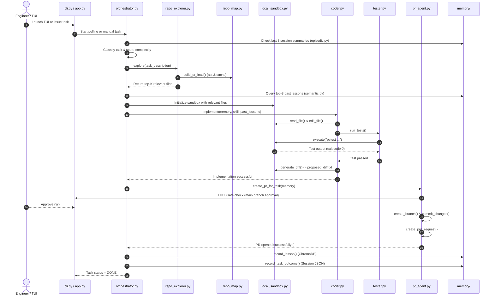

# CodePilot — Project Structure & Directory Guide

This document provides a detailed breakdown of the file and folder hierarchy for **CodePilot**, explaining the responsibilities of each module, class, and tool.

---

## 📁 Repository Directory Tree

```text
c:\AI Engineering Course\Projects\Capstone Project\
│
├── codepilot/                          # Core CodePilot package
│   ├── __init__.py                     # Package entry & version metadata
│   ├── config.py                       # Global configuration & environment settings
│   ├── state.py                        # Task models, working memory & state machine enums
│   ├── cli.py                          # Unified CLI entrypoint (TUI, Headless, Direct tasks)
│   │
│   ├── agents/                         # Multi-Agent subsystem
│   │   ├── __init__.py                 # Subagent exports
│   │   ├── orchestrator.py             # Root DeepAgent coordinator & planner
│   │   ├── repo_explorer.py            # Codebase analyzer & context retriever
│   │   ├── coder.py                    # Sandboxed implementation & surgical editor
│   │   ├── tester.py                   # Automated test runner & self-healing debugger
│   │   └── pr_agent.py                 # Branch manager, commit formatter & PR creator
│   │
│   ├── context/                        # Context engineering & repository mapping
│   │   ├── __init__.py                 # Context exports
│   │   ├── repo_map.py                 # AST symbol extractor, budget manager & cache
│   │   └── retrieval.py                # Keyword & ChromaDB embedding search algorithms
│   │
│   ├── sandbox/                        # Local execution isolation
│   │   ├── __init__.py                 # Sandbox exports
│   │   └── local_sandbox.py            # Isolated workspace, permission rules & diff preview
│   │
│   ├── guardrails/                     # Security policies & HITL gates
│   │   ├── __init__.py                 # Guardrails exports
│   │   ├── rules.py                    # Command blacklist & sensitive file protection
│   │   └── hitl.py                     # Human-in-the-Loop pause/resume controller
│   │
│   ├── skills/                         # Procedural engineering workflows
│   │   ├── __init__.py                 # Skills registry exports
│   │   ├── models.py                   # Structured Skill object definitions
│   │   ├── loader.py                   # Skill registry & task type resolver
│   │   ├── bug_fix_skill/              # Bug fix skill directory
│   │   │   └── SKILL.md                # reproduce → localize → fix → verify
│   │   ├── feature_addition_skill/     # Feature addition skill directory
│   │   │   └── SKILL.md                # explore_pattern → design → implement → test → document
│   │   ├── dependency_update_skill/    # Dependency update skill directory
│   │   │   └── SKILL.md                # check_changelog → update → resolve_conflicts → test_all
│   │   └── documentation_skill/        # Documentation skill directory
│   │       └── SKILL.md                # read_existing → draft → review_accuracy → update_index
│   │
│   ├── memory/                         # Three-tier memory management
│   │   ├── __init__.py                 # Memory exports
│   │   ├── working.py                  # Task-scoped in-memory state manager
│   │   ├── episodic.py                 # Session summary persistence & 3-run lookback
│   │   └── semantic.py                 # ChromaDB cross-session lessons learned vector store
│   │
│   ├── github/                         # GitHub integration layer
│   │   ├── __init__.py                 # GitHub exports
│   │   ├── client.py                   # Dual-mode client (Live GitHub API + Offline Mock)
│   │   └── toolkit.py                  # LangChain GitHub tools (list, inspect, branch, PR)
│   │
│   └── tui/                            # Terminal User Interface
│       ├── __init__.py                 # TUI exports
│       ├── app.py                      # Textual 4-panel dashboard application
│       └── event_bus.py                # Real-time thread-safe pub/sub event bus
│
├── sample_repo/                        # Target repository used for evaluation & testing
│   ├── pyproject.toml                  # Target repo configuration
│   ├── README.md                       # Target repo documentation
│   ├── src/
│   │   ├── auth/oauth.py               # Target OAuth handler (Issue #42 bug target)
│   │   └── metrics/report.py           # Target metrics reporting (Issue #45 feature target)
│   └── tests/
│       ├── test_oauth.py               # Unit tests for OAuth handler
│       └── test_metrics.py             # Unit tests for metrics service
│
├── tests/                              # Automated test suite (23 passing tests)
│   ├── test_agents.py                  # Sandbox, PR Agent, and subagent tests
│   ├── test_guardrails.py              # Command & file guardrail security tests
│   ├── test_memory.py                  # Working, episodic, and semantic memory tests
│   ├── test_orchestrator.py            # Classification, triage & state machine tests
│   ├── test_repo_map.py                # AST parsing, token budgeting & retrieval tests
│   ├── test_skills.py                  # Skill loading & prompt generation tests
│   └── test_tui.py                     # Textual headless pilot UI interaction tests
│
├── .codepilot_cache/                   # Runtime cache (ignored by Git)
│   └── repo_map_*.json                 # Cached Repo Map representations
├── .codepilot_data/                    # Persistent data storage (ignored by Git)
│   ├── memory/session_*.json           # Episodic memory session summaries
│   └── chroma/                         # ChromaDB vector store files
├── .codepilot_sandbox/                 # Task workspaces (ignored by Git)
│
├── .env                                # Local secrets & API keys (ignored by Git)
├── .env.example                        # Template for environment variables
├── .gitignore                          # Git exclusions for secrets & runtime data
├── pyproject.toml                      # Project metadata, dependencies & pytest config
├── README.md                           # Main project documentation & quickstart
├── IMPLEMENTATION_DETAILS.md           # Low-level architecture & algorithm deep dive
├── PROJECT_STRUCTURE.md                # This directory structure guide
└── PROJECT_FEATURES.md                 # Complete feature showcase & bonus explanations
```

---

## 🔍 Module-by-Module Breakdown

### 1. `codepilot/config.py`
- **Purpose**: Defines [`CodePilotConfig`](file:///c:/AI%20Engineering%20Course/Projects/Capstone%20Project/codepilot/config.py), managing environment variables, default paths, polling intervals, token budgets, and LLM model selection.
- **Key Attributes**:
  - `model_name`: Default LLM (e.g. `gemini-3.8-flash`).
  - `github_repository`: Target repo string (e.g. `devstream-labs/sample-repo`).
  - `poll_interval_seconds`: Issue polling frequency (default 300s).
  - `complexity_threshold`: Complexity cutoff for triage scoring (default 7).
  - `repo_map_token_budget`: Token limit for the Repo Map (default 4000).
  - `demo_mode`: Enables local offline simulation mode when true.

### 2. `codepilot/state.py`
- **Purpose**: Defines shared Pydantic data schemas and enumerations.
- **Key Classes**:
  - `TaskStatus`: State machine enum (`PENDING`, `TRIAGED`, `EXPLORING`, `IMPLEMENTING`, `TESTING`, `PR_OPENED`, `DONE`, `FAILED`, `SKIPPED`).
  - `TaskType`: Classification categories (`bug_fix`, `feature_addition`, `dependency_update`, `documentation`, `config_change`).
  - `IssueItem`: Representation of a GitHub issue.
  - `TaskWorkingMemory`: Task-scoped working memory tracking active issue, todos, files, diffs, and retry count.
  - `HITLApprovalRequest`: Payload surfaced to the user during human approval gates.

### 3. `codepilot/agents/`
Contains the specialist agents that form the multi-agent hierarchy:
- [`orchestrator.py`](file:///c:/AI%20Engineering%20Course/Projects/Capstone%20Project/codepilot/agents/orchestrator.py): The root coordinator. Instantiates `create_deep_agent()`, polls issues, classifies tasks, computes complexity scores, runs the state machine, and handles memory updates.
- [`repo_explorer.py`](file:///c:/AI%20Engineering%20Course/Projects/Capstone%20Project/codepilot/agents/repo_explorer.py): Inspects repository structure, generates compressed Repo Maps, and retrieves top-K relevant files without exceeding token budgets.
- [`coder.py`](file:///c:/AI%20Engineering%20Course/Projects/Capstone%20Project/codepilot/agents/coder.py): Executes the implementation inner loop inside an isolated sandbox, writes surgical edits, invokes verification tests, and generates unified diffs.
- [`tester.py`](file:///c:/AI%20Engineering%20Course/Projects/Capstone%20Project/codepilot/agents/tester.py): Executes the test suite in the sandbox, parses pytest stdout/stderr, and applies self-healing repairs if test setup or syntax issues occur.
- [`pr_agent.py`](file:///c:/AI%20Engineering%20Course/Projects/Capstone%20Project/codepilot/agents/pr_agent.py): Creates git branches (`codepilot/issue-{id}-{slug}`), formats structured commits, opens GitHub PRs, and validates branch safety gates.

### 4. `codepilot/context/`
Manages codebase understanding and context engineering:
- [`repo_map.py`](file:///c:/AI%20Engineering%20Course/Projects/Capstone%20Project/codepilot/context/repo_map.py): Parses AST nodes (classes, functions, methods, docstrings) across Python and JavaScript files, builds directory trees, enforces the 4000-token budget, and manages SHA-256 disk caching.
- [`retrieval.py`](file:///c:/AI%20Engineering%20Course/Projects/Capstone%20Project/codepilot/context/retrieval.py): Provides dual retrieval strategies: fast keyword-weighted scoring and ChromaDB vector embedding search over code chunks.

### 5. `codepilot/sandbox/`
Provides isolated execution:
- [`local_sandbox.py`](file:///c:/AI%20Engineering%20Course/Projects/Capstone%20Project/codepilot/sandbox/local_sandbox.py): Sets up isolated directories (`.codepilot_sandbox/<task_id>/`), enforces declarative permissions (`read_write` in sandbox, `read_only` elsewhere), prevents path traversal, and generates `working/proposed_diff.txt`.

### 6. `codepilot/guardrails/`
Provides safety layers:
- [`rules.py`](file:///c:/AI%20Engineering%20Course/Projects/Capstone%20Project/codepilot/guardrails/rules.py): Regex engine blocking dangerous commands (`rm -rf`, `curl`, `wget`, `pip install`) and protected sensitive files (`.env`, `*.secret`, `*.pem`, `*.key`, `*credentials*`).
- [`hitl.py`](file:///c:/AI%20Engineering%20Course/Projects/Capstone%20Project/codepilot/guardrails/hitl.py): Human-in-the-Loop controller pausing execution for PRs to `main`, commits $>5$ files, `git push`, retry counts $\ge 2$, or guardrail violations.

### 7. `codepilot/skills/`
Reusable engineering workflows:
- [`models.py`](file:///c:/AI%20Engineering%20Course/Projects/Capstone%20Project/codepilot/skills/models.py): Defines the structured `Skill` data model.
- [`loader.py`](file:///c:/AI%20Engineering%20Course/Projects/Capstone%20Project/codepilot/skills/loader.py): Maps task types to registered skills and exports skill directory paths.
- `bug_fix_skill/`, `feature_addition_skill/`, `dependency_update_skill/`, `documentation_skill/`: DeepAgents-compatible folders containing `SKILL.md` instructions.

### 8. `codepilot/memory/`
Three-tier memory subsystem:
- [`working.py`](file:///c:/AI%20Engineering%20Course/Projects/Capstone%20Project/codepilot/memory/working.py): Task-scoped in-memory state tracking.
- [`episodic.py`](file:///c:/AI%20Engineering%20Course/Projects/Capstone%20Project/codepilot/memory/episodic.py): Session-scoped records saved to disk; inspects the last 3 session summaries to avoid retrying recently failed tasks.
- [`semantic.py`](file:///c:/AI%20Engineering%20Course/Projects/Capstone%20Project/codepilot/memory/semantic.py): ChromaDB persistent vector database storing past solutions and injecting top-3 lessons into agent prompts.

### 9. `codepilot/github/`
GitHub operations:
- [`client.py`](file:///c:/AI%20Engineering%20Course/Projects/Capstone%20Project/codepilot/github/client.py): Unified GitHub client supporting live GitHub API via PyGitHub or simulated offline issues, branches, and PRs.
- [`toolkit.py`](file:///c:/AI%20Engineering%20Course/Projects/Capstone%20Project/codepilot/github/toolkit.py): LangChain tool adapters for DeepAgents integration.

### 10. `codepilot/tui/`
Terminal User Interface:
- [`app.py`](file:///c:/AI%20Engineering%20Course/Projects/Capstone%20Project/codepilot/tui/app.py): Textual application with 4 fixed panels (Issues Feed, Active Task, Agent Logs, Human Approval).
- [`event_bus.py`](file:///c:/AI%20Engineering%20Course/Projects/Capstone%20Project/codepilot/tui/event_bus.py): Thread-safe pub/sub event bus streaming updates across workers and UI panels.

---

## 🔄 End-to-End Data Flow

The diagram below illustrates how data and control flow across files during a task run:


