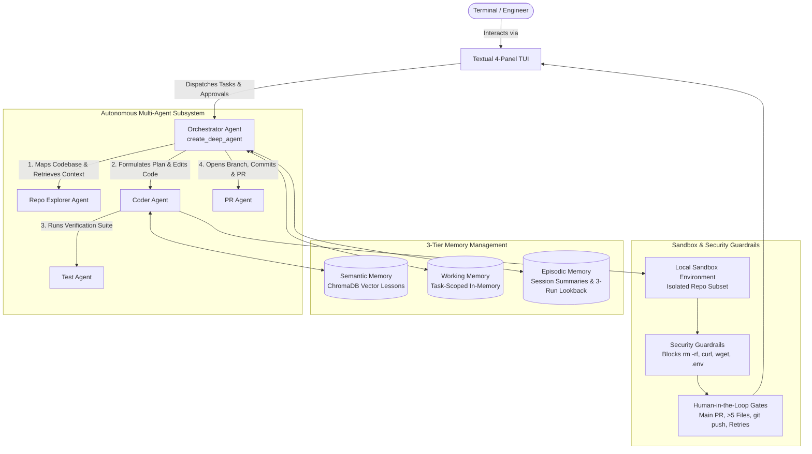

# CodePilot — Autonomous Terminal-Based AI Coding Platform

> **DevStream Labs Capstone Project**  
> An autonomous multi-agent coding system built with **DeepAgents**, **LangGraph**, **Textual**, and **ChromaDB**. CodePilot proactively polls GitHub repositories for unassigned issues, explores the codebase using compressed Repo Maps, formulates surgical implementation plans in an isolated sandbox, verifies solutions through automated testing, and opens structured Pull Requests with Human-in-the-Loop guardrails.

---

## 🏗️ Architecture Overview

CodePilot is architected as a hierarchical multi-agent system rooted in DeepAgents:



### Agent Responsibilities

| Agent | DeepAgents Role | Key Capabilities & Tools |
|---|---|---|
| **Orchestrator** | Root coordinator via `create_deep_agent()` | Task planning, `write_todos`, GitHub issue polling loop, Task classification, 3-tier memory management, State machine coordinator |
| **Repo Explorer** | Specialist subagent | Recursive Repo Map construction, AST symbol extraction, 4000-token budget discipline, keyword & ChromaDB embedding retrieval |
| **Coder** | Specialist subagent | Isolated local sandbox execution, surgical code edits, proposed diff generation (`working/proposed_diff.txt`), inner loop retry |
| **Test Agent** | Verification subagent | Test runner, pytest output parser, self-healing test setup meta-debugging |
| **PR Agent** | Delivery subagent | Git branch generation (`codepilot/issue-{id}-{slug}`), structured commit messages, PR formatting, conflict detection |

---

## 🚀 Key Features & Technical Implementation

### 1. Orchestrator State Machine & Polling Loop
- Continuous polling loop checking for issues labeled `ai-assignable` or unassigned tasks.
- **Orchestrator State Machine**:
  $$\text{TRIAGED} \longrightarrow \text{EXPLORING} \longrightarrow \text{IMPLEMENTING} \longrightarrow \text{TESTING} \longrightarrow \text{PR\_OPENED} \longrightarrow \text{DONE} \mid \text{FAILED}$$
- **Task Classification**: Automatically categorizes issues into:
  - `bug_fix`
  - `feature_addition`
  - `dependency_update`
  - `documentation`
  - `config_change`
- **Issue Triage Complexity Scoring (Bonus)**: Scores each issue 1–10 based on description and Repo Map context; skips tasks exceeding complexity threshold (default > 7) to avoid engineering churn.

### 2. Context Engineering & Repo Map
- **Token Budget Discipline**: Enforces a strict 4000-token budget for repository context. Automatically truncates verbose signatures and preserves high-level directory structure.
- **AST Symbol Extraction**: Extracts classes, functions, methods, and docstrings using Python's `ast` module.
- **Disk Caching & Invalidation**: Caches repo maps to `.codepilot_cache/` using SHA-256 hash validation over git status and file mtimes.
- **Dual Retrieval Strategies**:
  - **Keyword Retrieval**: Fast scoring over filenames, exported symbols, and module summaries.
  - **Embedding Retrieval**: Chunks code into ChromaDB collection and queries via cosine semantic similarity.
- **Context Hygiene**: Subagents receive strictly file paths on-demand, never raw file dumps.

### 3. Isolated Sandbox & Security Guardrails
- **Sandbox Isolation**: Creates `.codepilot_sandbox/<task_id>/` copying only the relevant subset of files needed for execution.
- **Declarative Permissions**:
  - `/sandbox/` &rarr; `read_write`
  - Outside sandbox &rarr; `read_only`
- **Strict Guardrail Engine**:
  - Blocks dangerous shell operations: `rm -rf`, `curl`, `wget`, `pip install`, path traversal outside sandbox boundaries.
  - Blocks access to sensitive files: `.env*`, `*.secret`, `*.pem`, `*.key`, `*credentials*`.
  - Blocked operations trigger an immediate **Human-In-The-Loop (HITL) interrupt** with full operation details.
- **Diff Preview**: Generates unified diffs saved to `working/proposed_diff.txt` prior to finalization.

### 4. 4 Pre-built Skills
All skills are stored as structured objects and compliant `SKILL.md` bundles:
- `bug_fix_skill`: `reproduce → localize → fix → verify`
- `feature_addition_skill`: `explore_pattern → design → implement → test → document`
- `dependency_update_skill`: `check_changelog → update → resolve_conflicts → test_all`
- `documentation_skill`: `read_existing → draft → review_accuracy → update_index`

### 5. 3-Tier Memory Architecture
- **Working Memory**: Task-scoped in-memory state tracking active issue, Repo Map, relevant files, diff, and retry counter. Cleared on completion.
- **Episodic Memory**: Session-scoped tracking with disk persistence. Automatically inspects the last 3 session summaries at startup to avoid re-attempting recently failed tasks.
- **Semantic Memory**: Persistent vector store in ChromaDB storing "lessons learned" (problem description, modified files, successful approach). Injects top-3 relevant past lessons into Coder context.

### 6. Human-In-The-Loop (HITL) Gates
CodePilot pauses and requests human approval in the TUI / terminal for:
1. Opening PR to `main` or `master` (irreversible without revert)
2. Committing more than 5 files (scope containment)
3. Any shell command containing `git push` (remote write operation)
4. Retrying after 2 failed test runs (loop prevention)
5. Blocked sensitive file edits or guardrail violations

### 7. Fixed 4-Panel Textual TUI
Built with **Textual**:
```
┌────────────────────────────────┬────────────────────────────────────────────┐
│  🐙 GitHub Issues Feed         │  ⚡ Active Task Details                     │
│  ────────────────────────────  │  ────────────────────────────────────────  │
│  #42 Fix null pointer ●        │  Issue #45: Add CSV export metrics API     │
│  #45 Add CSV export ●          │  Status: IMPLEMENTING                      │
│  #48 Upgrade pydantic ●        │  Agent: Coder (retry 1/3)                  │
│                                │  Skill: feature_addition_skill             │
│                                │  Todo: [✓] Explore pattern                 │
│                                │        [✓] Design interface                │
│                                │        [ ] Implement & test                │
├────────────────────────────────┼────────────────────────────────────────────┤
│  📜 Agent Activity & Logs      │  🛡️ Human-In-The-Loop Approval Gate       │
│  ────────────────────────────  │  ────────────────────────────────────────  │
│  [Orchestrator] Spawning...    │  ⚠ Coder wants to open PR to main          │
│  [RepoExplorer] 4 files found  │  (target is default production branch)     │
│  [Coder] Applied surgical fix  │                                            │
│  [TestAgent] All tests passed  │  [Approve (a)]  [Reject (r)]  [Inspect]    │
└────────────────────────────────┴────────────────────────────────────────────┘
  [i] New task   [s] Skip issue   [q] Quit   [l] Logs   [a] Approve   [r] Reject
```

---

## 📦 Installation & Setup

### Prerequisites
- Python 3.11 or 3.12 (Recommended: Python 3.12)
- `uv` package manager (optional but recommended)

### 1. Clone & Initialize
```bash
git clone https://github.com/vigneshraj1192/codepilot-agent.git
cd codepilot-agent

# Create virtual environment with uv or python venv
uv venv .venv --python 3.12
source .venv/bin/activate  # On Windows: .\.venv\Scripts\activate

# Install dependencies
uv pip install -e .
```

### 2. Environment Configuration
Create a `.env` file in the root directory:
```env
# LLM Providers
GOOGLE_API_KEY=your_gemini_api_key_here
CODEPILOT_MODEL_NAME=gemini-3.8-flash

# Optional: LangSmith Tracing
LANGSMITH_TRACING=true
LANGSMITH_API_KEY=your_langsmith_key
LANGSMITH_PROJECT=codepilot-devstream

# Optional: GitHub Integration
GITHUB_TOKEN=your_github_personal_access_token
GITHUB_REPOSITORY=devstream-labs/sample-repo

# CodePilot Settings
CODEPILOT_DEMO_MODE=true             # Set false when connecting to live GitHub
CODEPILOT_POLL_INTERVAL=300          # In seconds (e.g. 300 = 5 minutes)
CODEPILOT_TOKEN_BUDGET=4000          # Token limit for Repo Map
CODEPILOT_COMPLEXITY_THRESHOLD=7     # 1-10 scale; skips issues above this
```

---

## 🖥️ Running CodePilot

### 1. Launch Interactive Textual TUI
```bash
python -m codepilot.cli --mode tui
```
- Press `i` to enter a direct coding prompt.
- Press `a` to approve a pending HITL request.
- Press `r` to reject a pending HITL request.
- Press `s` to skip the active issue.
- Press `q` to safely exit and save session summaries.

### 2. Run Headless / CI Mode
Solve all pending issues autonomously:
```bash
python -m codepilot.cli --mode headless
```

Solve a specific issue number:
```bash
python -m codepilot.cli --mode headless --issue 45
```

Execute a free-form coding task directly from CLI:
```bash
python -m codepilot.cli --task "Add CSV export endpoint to metrics reporting service"
```

### 3. Run Automated Test Suite
```bash
pytest -v
```
All 23 unit and integration tests will execute, validating the state machine, sandbox, guardrails, skills, memory tiers, and TUI pilot.

---

## 📄 Example Autonomous PR

Here is an example of a pull request generated by CodePilot:

```markdown
## 🤖 CodePilot Autonomous PR

Closes #45

### 📋 Issue Summary
Engineering teams need to download raw weekly metrics in CSV format. Implement GET /api/v1/metrics/export?format=csv adhering to existing report formats and add comprehensive unit tests.

### 🛠️ Implementation Approach
- **Task Type**: `feature_addition`
- **Assigned Skill**: `feature_addition_skill`
- **Files Changed**: `src/metrics/report.py, tests/test_metrics.py`

### 🧪 Verification & Test Results
```text
tests/test_metrics.py::test_metrics_json PASSED [ 50%]
tests/test_metrics.py::test_metrics_csv_export PASSED [100%]
============================== 2 passed in 0.08s ==============================
```

### 🔍 Diff Preview
```diff
--- a/src/metrics/report.py
+++ b/src/metrics/report.py
@@ -14,3 +14,11 @@
     def get_metrics_json(self) -> List[Dict[str, Any]]:
         return self._sample_data
+
+    def export_metrics_csv(self) -> str:
+        output = io.StringIO()
+        fieldnames = ["date", "prs_merged", "bugs_fixed", "test_coverage"]
+        writer = csv.DictWriter(output, fieldnames=fieldnames)
+        writer.writeheader()
+        writer.writerows(self._sample_data)
+        return output.getvalue()
```
---
*Generated autonomously by CodePilot AI Assistant*
```

---

## 🎥 5–7 Minute Demo Walkthrough Guide

When recording your submission demo, follow this flow:
1. **Introduction (1 min)**: Explain DevStream Labs' problem, introduce CodePilot architecture and 4-panel TUI.
2. **Issue Polling & Triage (1.5 min)**: Show the GitHub polling loop detecting open issues, task classification (`feature_addition`), complexity scoring (skip issue #59 complexity 10/10), and skill loading.
3. **Execution & Sandboxing (1.5 min)**: Show Repo Explorer building the Repo Map within token budget, Coder creating the sandbox, executing tests, and producing unified diff.
4. **HITL Gate & Guardrails (1.5 min)**: Trigger a dangerous command (`rm -rf` or PR to `main`), show the Human Approval panel intercepting the operation, and demonstrate interactive approval/rejection.
5. **PR Opening & Semantic Memory (1 min)**: Show the generated PR with structured commit message and confirm the lesson learned was persisted into ChromaDB.

---

## 🛡️ License & Acknowledgments
Built for DevStream Labs. Powered by **DeepAgents**, **LangGraph**, **Google Gemini**, and **Textual**.
